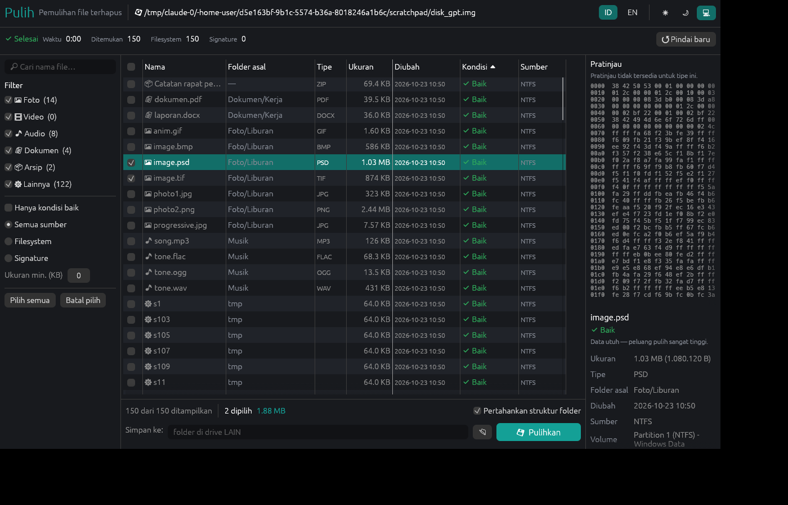
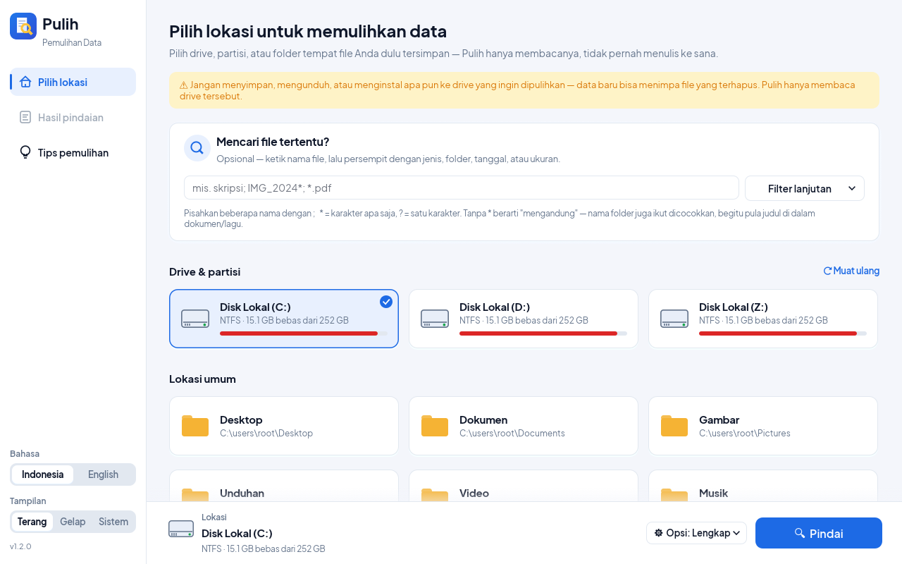
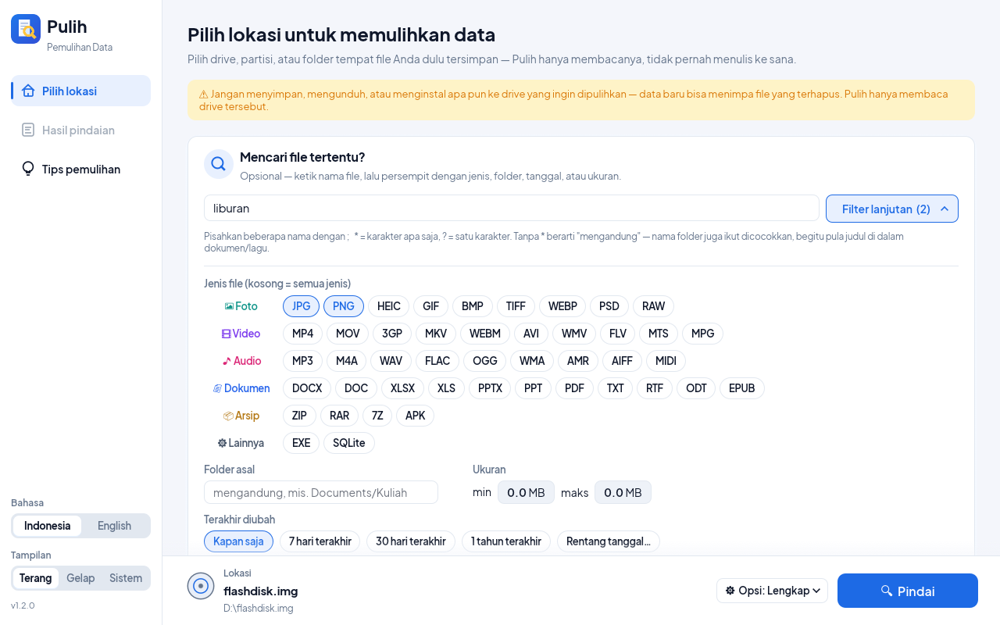
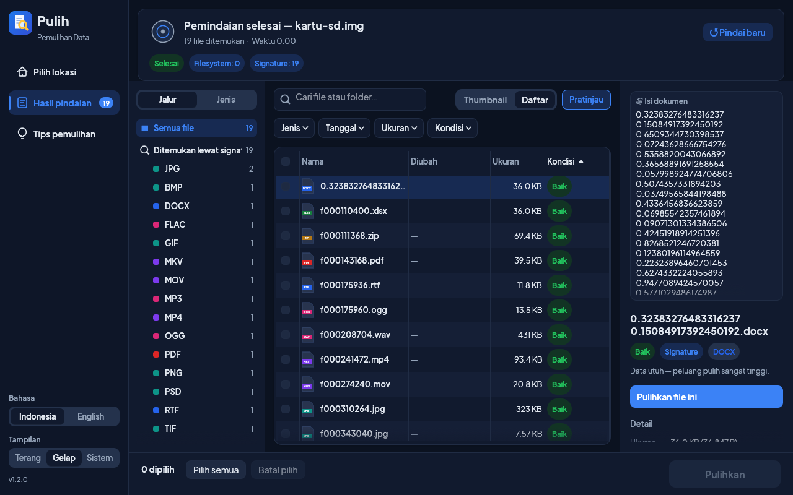

# Pulih — Pemulihan File Terhapus

**Pulih** adalah aplikasi desktop native untuk memulihkan file yang terhapus dari
hard disk, SSD, flashdisk, dan kartu SD. Ditulis dalam Rust, tanpa runtime atau
browser tertanam: satu file `.exe` sekitar 9 MB yang langsung jalan.

- **Cepat**: pencarian mendalam hanya dibatasi kecepatan disk. Engine-nya
  memproses **~5,8 GB/s** (data dari cache RAM), jauh di atas kecepatan SSD
  NVMe. Pindai cepat NTFS/FAT/exFAT selesai dalam hitungan detik.
- **Aman**: drive sumber hanya **dibaca**, tidak pernah ditulisi. Pulih menolak
  menyimpan hasil ke disk yang sama dan meminta konfirmasi bila Anda tetap
  mencobanya.
- **Akurat**: ukuran setiap file dihitung dari struktur internalnya (chunk PNG,
  box MP4, central directory ZIP, dsb.), jadi file hasil pulih tidak terpotong
  dan tidak berisi sampah di akhir.




## Fitur

| | |
|---|---|
| **Pindai cepat (metadata)** | NTFS (seluruh MFT, termasuk file terfragmentasi, file kecil *resident*, dan folder yang ikut terhapus), FAT12/16/32 (nama panjang/LFN dipulihkan), exFAT. Nama, folder asal, dan tanggal asli tetap terjaga. |
| **Pindai mendalam (signature)** | Mencari file dari isinya. Bisa dipakai pada drive yang sudah diformat, rusak, atau ber-filesystem lain (ext4, APFS, HFS+). Secara default hanya **ruang kosong** yang dipindai. |
| **Cari file tertentu** | Sebelum memindai, isi nama file (wildcard `*`/`?` didukung; tanpa wildcard juga mencocokkan nama folder), pilih jenis spesifik (JPG, HEIC, RAW, MP4, DOCX, PDF, …), folder asal, rentang tanggal, dan ukuran. Hasil langsung tersaring, dan pencarian mendalam **hanya mencari jenis yang dipilih**, jadi lebih cepat. Di layar hasil, kriteria yang sama bisa diubah kapan saja, ditambah pohon folder asal. |
| **Identitas dari isi file** | Hasil pencarian mendalam diberi nama dari isinya: judul dokumen Word/Excel/PowerPoint/ODF/PDF (atau kalimat pertamanya), "Artis - Judul" untuk MP3/FLAC. Foto diberi tanggal pengambilan (EXIF) dan model kamera; video diberi tanggal rekam. Jadi file tetap bisa dicari dengan nama dan tanggal walau metadata filesystem-nya sudah hilang. |
| **Penilaian kondisi** | Setiap hasil diberi label *Baik / Tak pasti / Sebagian / Tertimpa*, dihitung dari bitmap alokasi dan tumpang-tindih antar file terhapus. |
| **Partisi** | MBR (termasuk partisi extended), GPT (dengan nama partisi), atau volume langsung. Ruang di luar partisi (misalnya partisi yang terhapus) ikut dipindai. |
| **Pratinjau** | Foto ditampilkan langsung (JPG, PNG, GIF, BMP, WEBP, TIFF) beserta tanggal EXIF dan kamera. Dokumen Office/ODF menampilkan **isi teksnya**, judul, dan tanggal simpan, untuk memastikan "ini file yang saya cari". File lain ditampilkan sebagai teks atau hex. |
| **Sektor rusak** | Pembacaan tetap berjalan; sektor yang tidak terbaca diisi nol dan dihitung. |
| **Tampilan modern** | Navigasi samping, kartu drive dengan bar kapasitas, pintasan Desktop/Dokumen/Gambar/Unduhan, hasil dalam **daftar** atau **thumbnail foto**, panel kiri *Jalur* (pohon folder asal) dan *Jenis* (per kategori & ekstensi), filter Jenis/Tanggal/Ukuran/Kondisi, dan dialog pemulihan yang menuntun. Menyesuaikan diri dengan ukuran jendela. |
| **Bahasa & tema** | Indonesia (default) dan Inggris. Tema terang (default), gelap, atau mengikuti sistem. |

### Format yang dikenali pencarian mendalam

| Kategori | Format |
|---|---|
| Foto | JPEG (termasuk progresif), PNG, GIF, BMP, TIFF, WEBP, HEIC/HEIF, AVIF, PSD/PSB, RAW kamera: CR2, CR3, NEF, ARW, DNG, ORF, RW2, RAF, PEF, SRW |
| Video | MP4, MOV, M4V, 3GP, MKV, WEBM, AVI (termasuk OpenDML >1 GB), FLV, WMV/ASF, MPEG-PS (MPG/VOB), MPEG-TS, AVCHD (MTS/M2TS) |
| Audio | MP3 (ID3 maupun tanpa tag), WAV, FLAC (ukuran pasti lewat CRC-16 per frame), OGG, OPUS, M4A, WMA, AIFF, MIDI |
| Dokumen | PDF (termasuk revisi inkremental), DOCX, XLSX, PPTX, VSDX, ODT/ODS/ODP, EPUB, DOC/XLS/PPT/MSG (OLE2), RTF |
| Arsip | ZIP (termasuk ZIP64 dan data descriptor), RAR 4/5, 7Z, APK, JAR |
| Lainnya | SQLite, EXE/DLL/SYS (termasuk tabel simbol & sertifikat), ELF |

## Cara Install (Windows)

> ⚠ **Penting:** Jangan install Pulih di drive tempat file Anda hilang (contoh: jika file hilang di `D:`, install Pulih di `C:`).

1. Jalankan **`dist\Pulih-Setup-1.2.0.exe`** (atau unduh dari menu **Releases** di GitHub).
2. Klik **Yes** saat muncul permintaan izin Administrator (UAC).
3. Pilih **I accept the agreement** → klik **Next**.
4. *(Opsional)* Centang **Create a desktop shortcut** jika ingin ikon di Desktop → klik **Next**.
5. Klik **Install**, tunggu selesai, lalu klik **Finish** untuk langsung membuka **Pulih**.

*(Ingin tanpa install? Anda juga bisa langsung klik dua kali `target\release\pulih.exe` dari flashdisk).*

---

## Panduan Pengguna (Cara Pakai)

### A. Aplikasi Desktop (`pulih`)

1. **Buka Pulih** dari Start Menu atau Desktop (klik **Yes** pada UAC).
2. **Pilih Drive / Lokasi** tempat file Anda terhapus (misalnya `D:`, *Dokumen*, atau kartu SD).
   
3. **Cari File Tertentu *(Opsional)*:**
   - Ketik nama file di kotak pencarian (misal: `skripsi` atau `IMG_2024*.jpg`).
   - Klik **Filter lanjutan** bila ingin memilih jenis file saja (misal: **DOCX** + **PDF**), folder asal, atau tanggal.
   - *Kosongkan jika ingin melihat semua file yang bisa dipulihkan.*
   
4. **Klik Pindai:** Tunggu proses berjalan (hasil akan langsung muncul selama pemindaian).
5. **Cek & Pratinjau File:**
   - Pilih kategori di panel kiri (**Jalur** folder atau **Jenis** file).
   - Klik file untuk melihat pratinjau foto atau isi teks dokumen di panel kanan.
6. **Pulihkan File:**
   - Centang file yang ingin dikembalikan, lalu klik **Pulihkan (N)** di kanan bawah.
   - Pilih folder simpan di **drive lain** (bukan drive yang sedang dipindai), lalu klik **Pulihkan**.
   

### B. Lewat Terminal / CMD (`pulih-cli`)

Buka PowerShell atau Command Prompt sebagai **Administrator** (atau `sudo` di Linux):

```powershell
# 1. Lihat daftar drive
pulih-cli list

# 2. Pindai drive D: dan tampilkan daftar file terhapus
pulih-cli scan \\.\D: --list

# 3. Cari file "skripsi" di D: lalu simpan hasilnya ke C:\Hasil
pulih-cli scan \\.\D: --name "skripsi" --recover C:\Hasil

# 4. Pulihkan foto JPG & PDF saja dari D: ke C:\Hasil
pulih-cli scan \\.\D: --ext jpg,pdf --recover C:\Hasil
```

**Opsi tambahan `pulih-cli scan`:**
- `--quick-only` (hanya metadata, sangat cepat) | `--deep-only` (hanya signature) | `--all-space` (pindai seluruh ruang disk)
- `--types image,video,audio,document,archive,other` | `--ext jpg,docx,pdf` | `--name "pola*"` | `--folder NamaFolder`
- `--after YYYY-MM-DD` | `--before YYYY-MM-DD` | `--min-size BYTES` | `--max-size BYTES` | `--good-only` (hanya kondisi Baik)

## Mengapa cepat

```
            ┌──────────── 1 thread pembaca ────────────┐
 disk ──►   │ baca berurutan, blok 16 MB, buffer daur  │
            │ ulang (4 KB-aligned, tanpa alokasi baru) │
            └───────────────┬──────────────────────────┘
                            │ antrean terbatas (backpressure)
          ┌─────────────────┼─────────────────┐
          ▼                 ▼                 ▼
     worker 1          worker 2   …      worker N
  cek header hanya di awal sektor (1 dari 512 posisi)
  → resolver format menghitung ukuran pasti dari struktur
  → melompati payload (box MP4, chunk RIFF) tanpa membacanya
```

- **Satu aliran baca berurutan.** Pola akses tercepat untuk HDD, SSD, maupun
  USB. Thread pembaca tidak pernah menunggu CPU.
- **Hanya ruang kosong.** Dengan bitmap alokasi NTFS/FAT/exFAT, area yang
  dipakai file aktif dilewati. Pada disk yang 80% terisi, I/O-nya 5× lebih
  sedikit, dan file yang sudah ditemukan lewat metadata tidak dipindai ulang.
- **Cek per sektor, bukan per byte.** Di semua filesystem, file dimulai di
  batas cluster, jadi cukup memeriksa awal sektor. Mode per byte (Aho-Corasick
  SIMD, ~4,4 GB/s) tetap tersedia.
- **Resolver yang melompat.** Video 4 GB dianalisis dengan beberapa pembacaan
  kecil (header box), bukan 4 GB I/O tambahan.
- **Deduplikasi seketika.** Data di dalam file yang sudah tervalidasi (thumbnail
  EXIF, frame MP3, paket TS) tidak dianalisis ulang.

### Benchmark

Diukur pada image disk 4 GB berisi 1.356 file campuran yang sudah ada di cache
RAM, sehingga yang terukur adalah kecepatan engine, bukan kecepatan disk:

| Mode | 1 thread | 4 thread |
|---|---|---|
| Per sektor (default) | 5,85 GB/s | 4,47 GB/s |
| Per byte | 1,80 GB/s | 4,37 GB/s |

Pada disk sungguhan, pemindaian berjalan pada kecepatan baca disk itu sendiri:
±150 MB/s untuk HDD, ±500 MB/s untuk SSD SATA, dan beberapa GB/s untuk NVMe.

## Keterbatasan (jujur)

- **SSD dengan TRIM.** Setelah file dihapus, SSD biasanya mengosongkan
  blok-bloknya dalam hitungan detik hingga menit. Tidak ada perangkat lunak yang
  bisa memulihkan data yang sudah di-TRIM. Flashdisk dan kartu SD umumnya tidak
  terkena TRIM.
- **File terfragmentasi di FAT/exFAT.** Rantai cluster dihapus bersama filenya,
  jadi Pulih mengasumsikan cluster berurutan (benar untuk sebagian besar foto
  dan video kamera). Bila asumsi itu tidak berlaku, file ditandai *Sebagian*.
  Di NTFS, file terfragmentasi pulih utuh.
- **NTFS terkompresi atau terenkripsi (EFS).** File seperti ini dilewati, dan
  jumlahnya dicatat di log.
- **Hasil pencarian mendalam tidak punya nama asli.** Bila isinya punya judul
  (dokumen, lagu), judul itu dipakai sebagai nama; selain itu file diberi nama
  seperti `f000012345.jpg` (nomor sektor), dikelompokkan per tipe.
- **ext4/APFS** hanya didukung lewat pencarian mendalam.

## Membangun dari sumber & Membuat Installer

Perlu [Rust](https://rustup.rs) 1.95 atau lebih baru (`rustup update`).

### 1. Membangun Binary Release (Windows / Linux)

```sh
cargo build --release
# hasil: target/release/pulih (GUI) dan target/release/pulih-cli (CLI)
```

### 2. Membuat Installer Windows (`Pulih-Setup-1.2.0.exe`)

Pastikan [Inno Setup 6](https://jrsoftware.org/isinfo.php) sudah terpasang, lalu jalankan skrip pembangun installer dari PowerShell:

```powershell
powershell -ExecutionPolicy Bypass -File .\scripts\build-installer.ps1
# hasil: dist\Pulih-Setup-1.2.0.exe
```

Skrip ini secara otomatis membuat ikon aplikasi (`installer\pulih.ico`), mengompilasi binary release (`pulih.exe` dan `pulih-cli.exe`), lalu membungkusnya menjadi installer Windows menggunakan konfigurasi `installer\pulih.iss`.

### 3. Kompilasi Silang ke Windows dari Linux

```sh
rustup target add x86_64-pc-windows-gnu
sudo apt install gcc-mingw-w64-x86-64
cargo build --release --target x86_64-pc-windows-gnu
# hasil: target/x86_64-pc-windows-gnu/release/pulih.exe (manifest Administrator tertanam)
```

Di Linux, GUI membutuhkan pustaka X11/Wayland dan OpenGL yang umumnya sudah
tersedia di desktop.

## Struktur kode

```
crates/
  pulih-core/        engine (tanpa dependensi GUI)
    device.rs        akses disk mentah read-only, aligned I/O, toleran sektor rusak
    volume.rs        MBR / GPT / deteksi filesystem
    fs/ntfs.rs       pembaca MFT, runlist, $Bitmap, attribute list
    fs/fat.rs        FAT12/16/32, LFN terhapus, heuristik high-word FAT32
    fs/exfat.rs      entry set terhapus, bitmap alokasi
    carve/mod.rs     pipeline pembaca + worker paralel
    carve/formats.rs signature dan resolver ukuran untuk ±30 format
    carve/window.rs  akses byte untuk resolver (memori dulu, baru disk)
    carve/meta.rs    identitas dari isi: judul dokumen/PDF, EXIF, ID3/Vorbis, tanggal video
    target.rs        kriteria "file yang dicari": pola nama, jenis, folder, tanggal, ukuran
    inspect.rs       pratinjau isi dokumen & metadata untuk hasil mana pun
    scan.rs          orkestrasi, progres lock-free, aliran event
    recover.rs       penulisan hasil (berurutan sesuai posisi di disk)
  pulih-gui/         aplikasi desktop (egui)
    app.rs           state aplikasi, navigasi samping, halaman Tips
    home.rs          halaman awal: kartu drive/lokasi, pencarian, bar Pindai
    results.rs       hasil: progres, panel Jalur/Jenis, filter, daftar & thumbnail, pratinjau
    dialogs.rs       dialog pemulihan (tujuan, progres, selesai)
    theme.rs         sistem desain: palet terang/gelap, font, widget & ikon vektor
    find.rs          kriteria pencarian, pemilih jenis/tanggal/ukuran, pohon folder
    thumbs.rs        thumbnail foto di latar (pratinjau EXIF untuk JPEG)
  pulih-cli/         antarmuka baris perintah
installer/           konfigurasi Inno Setup (pulih.iss) dan ikon aplikasi (pulih.ico)
scripts/             skrip pembuatan installer (build-installer.ps1) & pengujian end-to-end
```

## Pengujian

```sh
cargo test --workspace            # unit test + uji carving sintetis
./scripts/gen_corpus.sh           # buat korpus file uji (ImageMagick, ffmpeg, …)
python3 scripts/carve_test.py     # 36 format diletakkan di antara data acak
./scripts/fs_test.sh ntfs         # buat FS, salin file, hapus, pulihkan, cocokkan MD5
./scripts/fs_test.sh fat32        # juga: fat16, exfat
```

Hasil pada versi ini:

- Carving: 36/36 file identik byte-per-byte, tanpa false positive.
- NTFS, FAT32, FAT16, dan exFAT: semua file yang dihapus pulih identik,
  termasuk folder yang ikut terhapus dan file NTFS terfragmentasi.
- Setelah quick format: 16/16 file pulih identik lewat pencarian mendalam.

## Lisensi

MIT. Antarmuka memakai font [Plus Jakarta Sans](https://github.com/tokotype/PlusJakartaSans)
(SIL Open Font License 1.1, lihat `crates/pulih-gui/assets/OFL-PlusJakartaSans.txt`).
